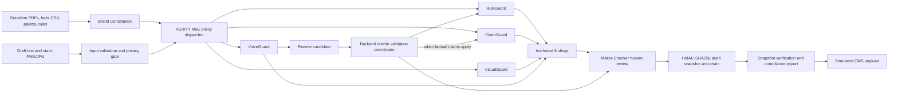
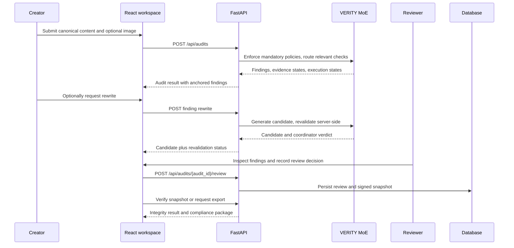

<div align="center">


# MoE-GUARDIAN

### Trust Every Claim. Govern Every Brand. Approve with Confidence.

**A pre-publication brand governance workspace by THE MOE**  
Powered by **VERITY MoE** — a hybrid, expert-orchestrated governance engine

</div>

---

## At a glance

MoE-GUARDIAN helps teams review marketing content against their own approved brand rules, product facts, and visual standards before publication. Its Round 2 MVP combines deterministic checks, evidence-linked claim review, static-image inspection, rewrite revalidation, accountable human review, and tamper-evident audit snapshots.

> **Scope note:** This README describes the implemented Round 2 MVP separately from proposed improvements. CMS export is simulated. The technical report records public deployment and live end-to-end smoke testing as in progress; it does not establish a verified production deployment or production security certification.

## What the Round 2 MVP does

| Capability | Implemented behavior |
|---|---|
| Brand Constitution | Manage rules, approved facts, and hexadecimal brand palette entries. PDF guidelines are parsed into staged rule suggestions that an administrator must confirm. |
| RuleGuard | Deterministically checks configured terminology, casing, disclaimers, and numeric bounds. |
| ClaimGuard | Compares claims with the Approved Facts Vault and reports `SUPPORTED`, `PARTIAL`, `CONTRADICTED`, or `UNVERIFIABLE`. |
| VisualGuard | Inspects static PNG/JPG submissions using OCR, palette distance (CIEDE2000), available contrast checks, and optional alt-text metadata. Unreliable visual regions can return `INSUFFICIENT_DATA`. |
| VoiceGuard | Analyzes tone and can suggest an on-demand, intent-preserving rewrite. A suggestion is not an approval. |
| Rewrite Validation Coordinator | Re-runs RuleGuard and, when relevant, ClaimGuard on every candidate. The backend fails closed unless required checks succeed, there are no rule violations, and any claim is supported. |
| Anchored findings | Associates findings with canonical document block IDs and surrounding context; edits invalidate stale anchors. |
| Maker-Checker review | Supports role-based human decisions, escalation, and required justification for overrides. |
| Audit and export | Creates HMAC-SHA256 signed, chained audit snapshots; offers snapshot verification and a compliance export containing a **simulated** CMS payload. |

## Architecture



### Review lifecycle



### VERITY MoE components

| Engine/component | Responsibility | Boundary |
|---|---|---|
| RuleGuard | Explicit, deterministic brand-policy checks | Checks configured rules; it does not determine external legal compliance. |
| ClaimGuard | Evidence matching against approved facts | `UNVERIFIABLE` means the vault lacks sufficient evidence; it does not prove a claim false. |
| VisualGuard | Static image text, palette, and accessibility subset | Complex image backgrounds may be insufficient for reliable contrast analysis. |
| VoiceGuard | Tone analysis and optional rewrite candidate | Does not approve its own output. |
| Rewrite Validation Coordinator | Backend-controlled revalidation of rewrite candidates | Fail-closed; the frontend must use the backend verdict. |

## Screenshots

No application screenshots were available in the repository snapshot inspected for this README. This section intentionally contains no mockups or generated interface images. Add genuine, current screenshots here when they are available, with captions and any necessary redaction of private data.

## Technology stack

| Layer | Round 2 implementation |
|---|---|
| Frontend | React, TypeScript, Vite, Tailwind CSS, Lucide React |
| API | Python, FastAPI, Pydantic v2 |
| Persistence | SQLAlchemy 2.x; SQLite for local development; Supabase PostgreSQL is the documented hosted target |
| PDF and image handling | PyMuPDF and Pillow |
| OCR and visual analysis | Tesseract via pytesseract; CIEDE2000 color-distance calculations |
| Integrity | HMAC-SHA256 signed audit snapshots and previous-snapshot hash chaining |
| Reported verification | Pytest, HTTPX, TypeScript/Vite production build |
| Hosting topology in report | Render static site and web service; Supabase PostgreSQL target. Final live deployment was not yet verified in the report. |

## API and workflow

The documented API is rooted at `/api`. The running FastAPI OpenAPI document is the authority for the actual registered routes and schemas.

| Method | Endpoint | Purpose |
|---|---|---|
| `GET` | `/api/health` | Backend health check |
| `GET` | `/api/auth/me` | Resolve authentication and tenant context |
| `GET` | `/api/demo/workspace` | Load configured demo workspace |
| `GET`, `POST` | `/api/brand/rules` | List and create brand rules |
| `POST` | `/api/brand/guidelines/upload-pdf` | Upload and stage guideline-derived rules |
| `POST` | `/api/brand/guidelines/{batch_id}/confirm` | Confirm staged rules |
| `GET`, `POST` | `/api/brand/facts` | List and create approved facts |
| `POST` | `/api/brand/facts/upload-csv` | Validate and import approved facts from CSV |
| `GET`, `POST` | `/api/brand/palette` | List and add palette entries |
| `POST` | `/api/audits` | Run a governance audit |
| `GET` | `/api/audits/{audit_id}` | Retrieve audit details and findings |
| `POST` | `/api/audits/{audit_id}/findings/{finding_id}/rewrite` | Generate and revalidate a rewrite candidate |
| `POST` | `/api/audits/{audit_id}/review` | Record Maker-Checker decisions |
| `GET` | `/api/audits/{audit_id}/verify-snapshot` | Verify snapshot integrity |
| `GET` | `/api/audits/{audit_id}/export` | Retrieve compliance export and simulated CMS payload |

In practice, the frontend loads the workspace and governance assets, submits content, displays anchored findings, optionally requests rewrites, presents backend revalidation results, records the human review, then verifies the snapshot and requests the export.

## Local development

The project layout and exact commands must be confirmed against the repository checkout. The technical report identifies `backend/` and `frontend/` as the service roots. From the repository root, a typical local setup is:

### Backend

```bash
cd backend
python -m venv .venv
# Activate .venv for your operating system, then:
python -m pip install -r requirements.txt
uvicorn app.main:app --reload
```

The report documents SQLite as the local-development database. Set local configuration in an untracked environment file according to the actual backend settings and example file. Do not put real signing keys or credentials in source control.

### Frontend

In a second terminal:

```bash
cd frontend
npm ci
npm run dev
```

Configure `VITE_API_BASE_URL` to point to the local API using the format expected by the frontend. The deployed configuration is documented with `VITE_USE_MOCK_ADAPTER=false`; follow the checked-in environment example and application settings for the local value.

> **Dependency note:** VisualGuard uses Tesseract OCR. Install the system Tesseract executable as well as the Python project dependencies before expecting OCR-based checks to work. Confirm current requirements and environment variable names from the repository files before deploying.

## Deployment topology and verification status

The Round 2 report describes the following intended topology:

1. **Frontend:** Render Static Site, built from `frontend/` into `dist/` with `npm ci --include=dev && npm run build`.
2. **Backend:** Render Web Service, built from `backend/` with `pip install -r requirements.txt` and started with `uvicorn app.main:app`.
3. **Database:** Supabase PostgreSQL as the hosted target; SQLite for local development.

The report records a successful frontend production build and 69 passing automated backend Pytest checks. It also records public deployment and the live cross-service smoke test as pending confirmation. PostgreSQL Row-Level Security migration files alone do not confirm that RLS is enabled on a hosted database. Verify deployed services, database policy application, tenant isolation, and production configuration before describing them as live or certified.

## Limitations and engineering boundaries

- ClaimGuard checks against the supplied Approved Facts Vault; it is not a source of external truth or a substitute for legal/regulatory review.
- Missing evidence produces `UNVERIFIABLE`, not a verdict that a claim is false.
- Visual checks cover static PNG/JPG assets. OCR and automated contrast estimates can be uncertain on gradients, shadows, overlays, or complex backgrounds; these cases require human review.
- Alt-text checking applies to optional metadata submitted with the audit. It does not validate alt text in a publishing platform.
- Editing analyzed content invalidates prior anchors and requires a fresh analysis. Ambiguous repeated text may fall back to a block-level warning.
- HMAC signing and chaining can reveal certain snapshot modifications, but alone do not prevent privileged deletion of the chain tail, full database rollback, or complete history replacement.
- The compliance export's CMS payload is simulated; there is no live CMS integration documented.
- English-first text, static imagery, and the reported MVP scope do not establish broad multilingual, video, audio, or 3D-media support.
- Automated tests and a successful build are engineering checks, not a production security certification.

## Proposed roadmap (not part of the implemented MVP)

The Round 2 report names these as future improvements. They should be treated as proposals unless implementation and verification evidence is added:

1. **Structured, qualifier-aware evidence intelligence:** parse units, ranges, comparators, locale formats, and testing qualifiers; flag stale or conflicting facts.
2. **Expanded visual intelligence:** inspect multi-page PDFs and carousels, with CLIP similarity as a supplementary human-review signal.
3. **Guideline ambiguity signals and deeper privacy controls:** surface recurring review disagreements after sufficient data exists and extend baseline masking into a multi-stage redaction pipeline.

The report also places native CMS/design integrations, self-hosted or air-gapped model serving, external append-only audit anchoring, and video/audio review in future scope. None are claimed as current Round 2 capabilities.

## Team THE MOE

| Member | Documented role | Project contribution |
|---|---|---|
| **Divy Mishra** | Team Leader — Backend and AI Systems Architect | FastAPI backend, Pydantic contracts, VERITY MoE orchestration, core governance engines, rewrite validation, tenant/security architecture, and HMAC audit snapshots. |
| **Lavanya Bani** | Frontend and Product Experience Lead | React/TypeScript workspace, document and findings experience, rewrite and review workflows, frontend/API integration, and integration/UX verification. |

### Aura corner (strictly for fun)

These are playful, non-technical shout-outs based only on the roles documented above. No hidden superpowers were harmed in their creation.

- **Divy Mishra — The Calm-Core Aura:** backend-and-AI-systems lead energy, with a side of “let the evidence speak.”
- **Lavanya Bani — The Experience-Glow Aura:** product-experience lead energy, bringing the user journey into the spotlight.

<div align="center">

**THE MOE · MoE-GUARDIAN · SIUUUU**

</div>
